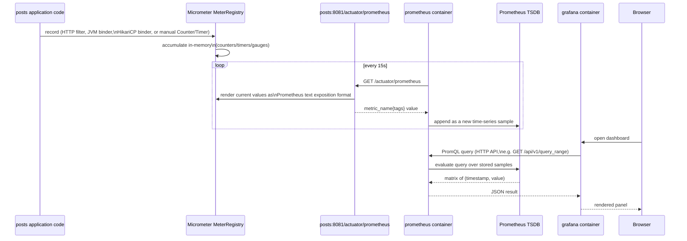
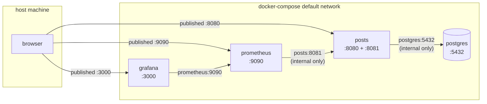

# Monitoring Architecture

How a metric gets from Java code in `posts` to a Grafana panel: the
mechanism, at the same container level as
[`OVERALL-ARCHITECTURE.md`](OVERALL-ARCHITECTURE.md). For day-to-day use
(viewing, querying, adding metrics), see
[`backend/posts/docs/observability.md`](backend/posts/docs/observability.md).

This doc describes the Docker Compose stack. Local Kubernetes runs the same
pipeline: its Prometheus mounts the same `prometheus.yml` and scrapes the
`posts` Service on `8081`, which the Gateway never routes
([`deploy/kubernetes/README.md`](deploy/kubernetes/README.md)).

## Table of Contents

- [1. End-to-End Data Flow](#1-end-to-end-data-flow)
- [2. Inside `posts`: Micrometer](#2-inside-posts-micrometer)
- [3. The Management-Port Split](#3-the-management-port-split)
- [4. Prometheus: the Scraper](#4-prometheus-the-scraper)
- [5. Grafana: the Viewer](#5-grafana-the-viewer)
- [6. Docker Compose Wiring](#6-docker-compose-wiring)
- [7. Config File Map](#7-config-file-map)

## 1. End-to-End Data Flow



Three properties of this design:

- **Pull, not push.** `posts` never connects to Prometheus or Grafana. It
  exposes a text endpoint of Micrometer's current in-memory values and
  doesn't know whether anything scrapes it.
- **Prometheus owns history.** `posts` keeps only current values, which
  reset on restart. All windowed math (`rate()`, `histogram_quantile()`)
  runs in Prometheus over the samples it has stored.
- **Grafana never touches `posts`.** It only queries Prometheus's HTTP API.
  Removing Grafana wouldn't affect scraping or retention.

## 2. Inside `posts`: Micrometer

Two dependencies in `backend/posts/pom.xml` provide all of this with no
application code:

- **`spring-boot-starter-actuator`** brings in Micrometer core plus
  auto-configuration that:
  - Registers a global `MeterRegistry` bean you can inject anywhere (see
    [`observability.md` §4](backend/posts/docs/observability.md#4-adding-your-own-metrics)).
  - Times every servlet request as `http.server.requests`, tagged `uri`,
    `method`, `status`, `outcome`. `uri` is the route template
    (`/posts/{postId}`), so per-ID URLs don't each become a series.
  - Registers JVM binders (memory, GC, threads, CPU) that read the JVM's
    MXBeans on demand.
  - Binds HikariCP pool stats, because a `HikariDataSource` bean already
    exists in the context.
  - Serves `/actuator/*` from a second embedded Tomcat context
    ([§3](#3-the-management-port-split)).
- **`micrometer-registry-prometheus`** adds `PrometheusMeterRegistry`,
  which translates Micrometer meters into Prometheus's text format and
  provides `/actuator/prometheus`. Without it, metrics are still collected
  but there's no endpoint to scrape.

The `management:` block in
[`application.yml`](backend/posts/src/main/resources/application.yml)
only tunes this auto-configuration: port, exposed endpoints, histogram
buckets.

## 3. The Management-Port Split

`management.server.port: 8081` (vs. `server.port: 8080`) makes Spring Boot
start a **second Tomcat connector** in the same JVM. The startup log shows
both:

```
Tomcat started on port 8080 (http) with context path ''       <- the app
Tomcat initialized with port 8081 (http)                      <- actuator
Exposing 3 endpoints beneath base path '/actuator'
Tomcat started on port 8081 (http) with context path ''
```

Same process and `MeterRegistry`, but two sockets with separate servlet
contexts. Two consequences:

- **`SecurityConfig` never sees port 8081.** Its `SecurityFilterChain`
  belongs to the main servlet context; the management context is a
  separate child `ApplicationContext`. Its `anyRequest().permitAll()` has
  no bearing on `/actuator/*`.
- **Spring Boot's actuator auto-security backs off.**
  `ManagementWebSecurityAutoConfiguration` would put actuator behind HTTP
  Basic (the generated password in the startup log), but only when the
  management port equals the app port. On a separate port, Spring assumes
  the network boundary (firewall, unpublished port, NetworkPolicy) is the
  control.

[`docker-compose.yml`](docker-compose.yml) supplies that boundary by
publishing `8080` but not `8081`. Only containers on the compose network
(in practice `prometheus`) can reach `posts:8081`.

## 4. Prometheus: the Scraper

The `prometheus` service runs stock `prom/prometheus` with one bind-mounted
config,
[`deploy/docker/prometheus/prometheus.yml`](deploy/docker/prometheus/prometheus.yml).
Its `scrape_configs` is a static target, `posts:8081` at
`/actuator/prometheus`, every 15s. `posts` resolves through Compose's
built-in DNS (the same way `posts` reaches `postgres:5432`), so there are
no IPs or service discovery.

Samples go to Prometheus's on-disk TSDB in the `prometheus-data` volume.
History survives `docker compose down` but not `down -v` or
`docker-hard-clean.sh`. Retention is capped at 15 days
(`--storage.tsdb.retention.time=15d`).

## 5. Grafana: the Viewer

Grafana connects only to `prometheus`. Its config is provisioned from two
read-only bind mounts, loaded at startup, so a fresh clone gets the same
setup with no UI clicks:

- [`datasources/datasource.yml`](deploy/docker/grafana/provisioning/datasources/datasource.yml)
  registers `http://prometheus:9090` with a fixed `uid: prometheus`.
- [`dashboards/`](deploy/docker/grafana/provisioning/dashboards/) holds a
  provider config and
  [`posts-overview.json`](deploy/docker/grafana/provisioning/dashboards/posts-overview.json).
  Panels reference the datasource by that fixed uid, which is why it's
  hardcoded rather than auto-generated.

To render a panel, Grafana sends its PromQL `expr` (e.g.
`histogram_quantile(0.95, sum(rate(http_server_requests_seconds_bucket{job="posts"}[5m])) by (le))`)
to Prometheus and draws the returned matrix. Grafana computes nothing
itself.

## 6. Docker Compose Wiring



| Service | Image | Publishes to host | Reaches | Volume |
|---|---|---|---|---|
| `posts` | built locally | `8080` only (`8081` is **not** published) | `postgres:5432` | none |
| `prometheus` | `prom/prometheus:v3.14.0` | `9090` | `posts:8081` | `prometheus-data` (TSDB) |
| `grafana` | `grafana/grafana:13.2.2` | `3000` | `prometheus:9090` | `grafana-data` (settings DB, sessions) |

`depends_on` orders startup (`posts` → `prometheus` → `grafana`) but
doesn't wait for readiness. Prometheus's 15s scrape retry is what covers
`posts` still starting.

## 7. Config File Map

| File | Controls |
|---|---|
| [`backend/posts/pom.xml`](backend/posts/pom.xml) | Actuator, the Prometheus registry, and the `build-info` goal for `/actuator/info` |
| [`application.yml`](backend/posts/src/main/resources/application.yml) (`management:`) | Management port, exposed endpoints, health probes, histograms |
| [`docker-compose.yml`](docker-compose.yml) | Services, host ports, volumes, container reachability |
| [`prometheus.yml`](deploy/docker/prometheus/prometheus.yml) | Scrape targets and interval |
| [`datasource.yml`](deploy/docker/grafana/provisioning/datasources/datasource.yml) | Grafana → Prometheus connection |
| [`posts-overview.json`](deploy/docker/grafana/provisioning/dashboards/posts-overview.json) | Dashboard panels |
| [`.env` / `.env.example`](.env.example) | `PROMETHEUS_PORT`, `GRAFANA_PORT`, `GRAFANA_ADMIN_PASSWORD` |
