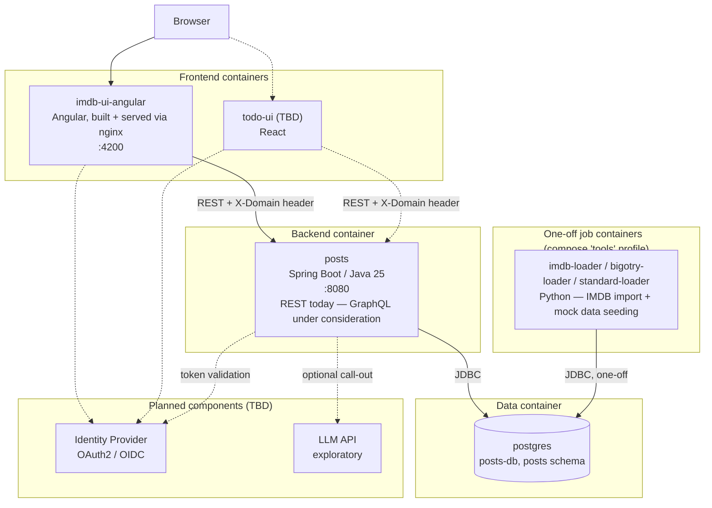
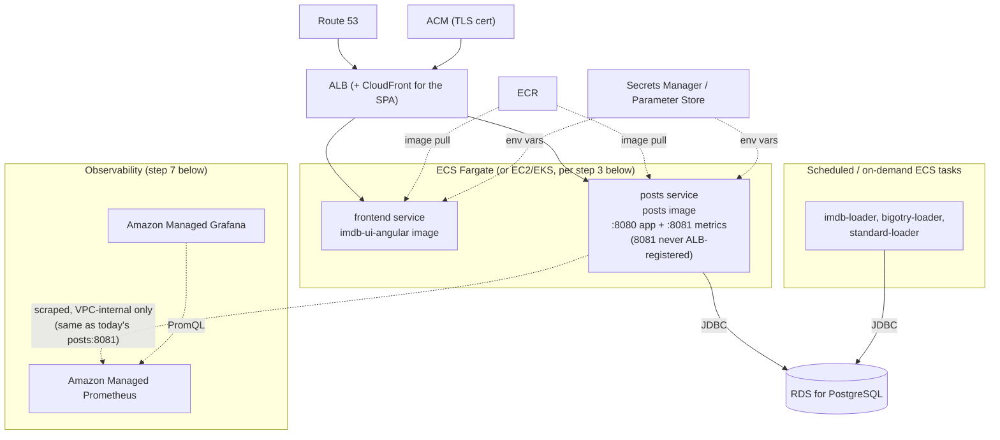

# Overall Architecture

The app hosts several communities, each rating IMDB titles its own way.
Users post about a title and reply in threads; a UI picker switches
communities. In code, a community is a **domain**:

| Community | Domain | What it's about |
|---|---|---|
| **Big-O-Meter** | `imdb/bigotry` | Flags titles for racism, sexism and LGBTQ+-phobia, each with a 0–5 severity. |
| **Movie-Meter** | `imdb/standard` | A plain rating: skip it, it was okay, I enjoyed it, I loved it. No severity. |

This doc is the container-level view: what runs, how it connects, and how
it stays pluggable. Code-level detail is in the component docs
([§4](#4-component-documentation)). To see the app itself, start with the
[UI User Guide](frontend/imdb-ui-angular/docs/user-guide.md).

## Table of Contents

- [1. System Overview](#1-system-overview)
- [2. Container Topology](#2-container-topology)
- [3. Pluggable Domain Model](#3-pluggable-domain-model)
- [4. Component Documentation](#4-component-documentation)
- [5. AWS Deployment Feasibility](#5-aws-deployment-feasibility)
- [6. Planned Extensions](#6-planned-extensions)

## 1. System Overview

A Spring Boot REST API (`posts`) on PostgreSQL, serving one or more SPAs.
It runs on a single host under Docker Compose, or on Docker Desktop's
local Kubernetes ([`deploy/kubernetes/README.md`](deploy/kubernetes/README.md)).

Every table, service call and endpoint is partitioned by domain, taken
from a request header, so unrelated frontends can share one backend and
database with no schema change ([§3](#3-pluggable-domain-model)).

## 2. Container Topology

Solid lines run today; dashed lines are planned ([§6](#6-planned-extensions)).

One `docker-compose.yml` at the repo root:

- **Services.** `postgres`, `posts`, `frontend`, `prometheus` and `grafana`
  are long-running (`docker compose up`). `imdb-loader`, `bigotry-loader`
  and `standard-loader` are one-off jobs in the `tools` profile, run with
  `docker compose run --rm <job>`. `prometheus` and `grafana` are
  observability only, outside the request path
  ([`MONITORING-ARCHITECTURE.md`](MONITORING-ARCHITECTURE.md)).
- **Networking.** Services talk over Compose DNS (`posts` → `postgres:5432`).
  Only browser-facing ports are published (`4200`, `8080`, and Postgres on
  `5433` for inspection), all set in `.env`.
- **Images.** `posts` and `imdb-ui-angular` are multi-stage builds
  (JDK → JRE, Node → nginx), so runtime images carry no build tooling.
- **Runtime config, not build-time.** The backend reads its datasource URL
  and CORS origin from env vars. The frontend's entrypoint writes the API
  URL to `/config.json` at container startup. Either image moves to a new
  environment without a rebuild, which [§5](#5-aws-deployment-feasibility)
  relies on.

## 3. Pluggable Domain Model

Every domain-owned table has a `domain_id`, and every request names its
domain in an `X-Domain` header, resolved server-side first. Composite
foreign keys on the three derived tables guarantee a resource, post or
flag can never reference another domain's row: a database constraint, not
a convention.

On the frontend, one `DomainConfig` per domain drives rating behavior,
labels and theme, with no per-domain branching in components.

**Effect:** a new domain is a Flyway migration plus, if it needs a UI, one
frontend config file. No new service, no schema change. Everything in
[§6](#6-planned-extensions) plugs in here.

Details: [backend multi-domain design](backend/posts/docs/architecture.md#8-multi-domain-design),
[frontend domain configuration](frontend/imdb-ui-angular/docs/architecture.md#4-domain-configuration-system).

## 4. Component Documentation

| Component | Role | Docs |
|---|---|---|
| `backend/posts` | REST API, owns the schema (Flyway) | [`architecture.md`](backend/posts/docs/architecture.md), [`design-spec.md`](backend/posts/docs/design-spec.md) |
| `frontend/imdb-ui-angular` | SPA for `imdb/bigotry` and `imdb/standard` | [`architecture.md`](frontend/imdb-ui-angular/docs/architecture.md), [`design-spec.md`](frontend/imdb-ui-angular/docs/design-spec.md), [`user-guide.md`](frontend/imdb-ui-angular/docs/user-guide.md) |
| `backend/imdb-data-python` | One-off IMDB import + mock-data jobs | [`README.md`](backend/imdb-data-python/README.md), [`CLAUDE.md`](backend/imdb-data-python/CLAUDE.md) |
| Full stack / local dev | Compose usage, ports, env config | [`README.md`](README.md), [`CLAUDE.md`](CLAUDE.md) |
| Local Kubernetes | Kustomize base + `local` overlay | [`deploy/kubernetes/README.md`](deploy/kubernetes/README.md) |
| Monitoring (`prometheus`, `grafana`) | Micrometer → Prometheus → Grafana | [`MONITORING-ARCHITECTURE.md`](MONITORING-ARCHITECTURE.md), [`observability.md`](backend/posts/docs/observability.md) |

## 5. AWS Deployment Feasibility

Mostly an infrastructure change. Because of the runtime config in
[§2](#2-container-topology), none of the three images needs code changes;
only where config and secrets come from, and what runs and exposes the
containers, changes.

Migration steps, in natural order:

1. **Registry.** Define the stack in AWS CDK. `DockerImageAsset` builds the
   existing Dockerfiles unchanged and pushes to a CDK-managed ECR repo
   during `cdk deploy`.
2. **Database.** Provision RDS for PostgreSQL and point `posts` at it with
   `SPRING_DATASOURCE_URL`, now sourced from Secrets Manager instead of
   `.env`.
3. **Compute.** Run `posts` and `frontend` as ECS tasks; task definitions
   replace the compose service blocks 1:1. Pick one launch option:
   - **Fargate**: serverless, no instances to manage. Assumed elsewhere in
     this doc.
   - **EC2** (ECS EC2 launch type, or `docker compose up` on one instance):
     cheaper at current scale, but you manage the instances.
   - **EKS**: if Kubernetes ([§6](#6-planned-extensions)) is chosen over
     ECS. Adds a $0.10/hr control-plane fee on top of the worker nodes.

   The `posts` task declares both ports, but only `8080` is registered with
   the ALB target group, the equivalent of compose not publishing `8081`
   ([`MONITORING-ARCHITECTURE.md` §3](MONITORING-ARCHITECTURE.md#3-the-management-port-split)).
   The task's own container health check hits
   `http://localhost:8081/actuator/health/readiness` inside the task; the
   ALB health check stays on the app port. So `8081` only affects ECS task
   health, never routing.
4. **Batch jobs.** Run the three loaders as scheduled or on-demand ECS
   tasks (EventBridge Scheduler or `RunTask`), as the compose `tools`
   profile does today.
5. **Edge.** An ALB in front of both services (optionally CloudFront for
   the frontend), an ACM certificate and a Route 53 record. The frontend's
   `API_BASE_URL` becomes the ALB's DNS name, written to `/config.json` by
   the same entrypoint.
6. **Secrets/config.** Move `.env` values (`POSTGRES_PASSWORD`,
   `SPRING_DATASOURCE_*`, `APP_CORS_ALLOWED_ORIGINS`, `API_BASE_URL`) to
   Secrets Manager / Parameter Store, injected as task env vars.
7. **Observability.** `prometheus`/`grafana` map onto Amazon Managed
   Prometheus (AMP) and Amazon Managed Grafana (AMG). An AMP scraper or
   ADOT Collector sidecar pulls each task's `8081/actuator/prometheus`
   over the VPC: same pull model, same unpublished management port, with
   AWS service discovery instead of Compose DNS. AMG imports
   [`posts-overview.json`](deploy/docker/grafana/provisioning/dashboards/posts-overview.json)
   unchanged and replaces `GRAFANA_ADMIN_PASSWORD` with IAM/SSO login.
   Running the existing images as two more ECS tasks is also valid and
   cheaper at this scale, but then you own TSDB storage, HA and backups.
8. **Deploys.** `cdk deploy` from a laptop covers build, push and update
   for a solo deploy. CI (`.github/workflows/quality.yml`) runs only the
   quality and security gates today; a workflow running `cdk deploy` on
   merge is the next step if more people deploy.

## 6. Planned Extensions

Not started; listed because they shape [§2](#2-container-topology),
[§3](#3-pluggable-domain-model) and [§5](#5-aws-deployment-feasibility).

- **`todo-ui` (React).** A list is a `resource`, an item is a `post`, and
  status (`Waiting`/`In-Progress`/`Done`) is a `post_type`, with `Waiting`
  carrying severity like `imdb/bigotry`'s flag types. A new domain via
  [§3](#3-pluggable-domain-model), not a new service.
- **Identity Provider.** OAuth2/OIDC, replacing today's username-only
  placeholder auth (no password, no token) in every frontend.
- **LLM API.** Exploratory. One candidate use is summarizing search
  results. Whether it's sync, async or a separate service is undecided.
- **GraphQL.** Under consideration alongside or instead of REST.
- **Kubernetes beyond local.** Local manifests exist and run the whole
  stack on Docker Desktop ([`deploy/kubernetes/`](deploy/kubernetes/README.md)).
  A real cluster (EKS or otherwise) is not started.
