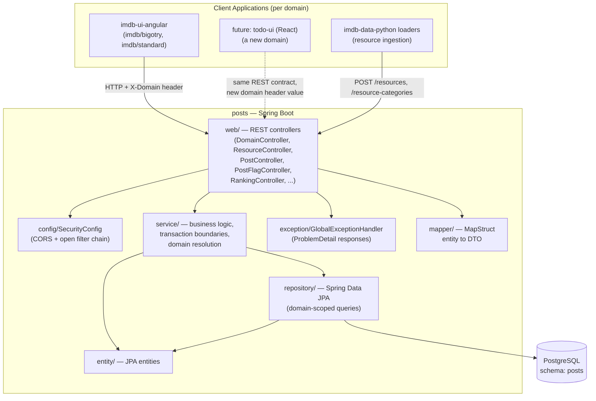
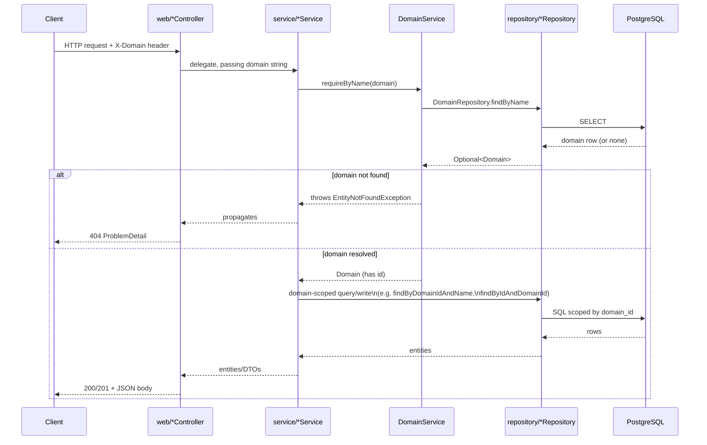
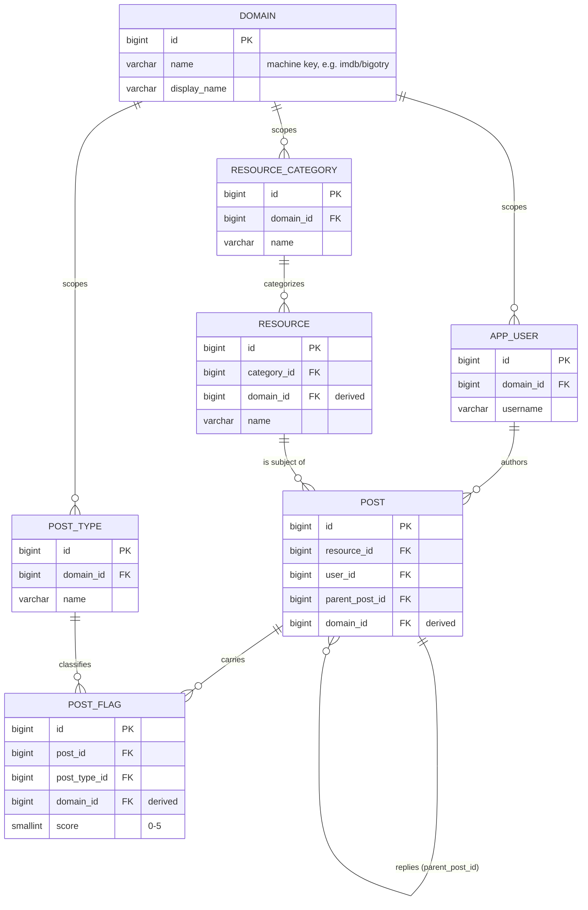

# Posts Service — Architecture

How the `posts` backend is built and, above all, how it stays
domain-agnostic, so one schema, service layer and REST API can serve
different kinds of apps.

Not the data-model spec: tables, constraints and the decision log are in
[`design-spec.md`](./design-spec.md) and
[`db-design-spec.md`](./db-design-spec.md). Running locally:
[`running-locally.md`](./running-locally.md).

## Table of Contents

- [1. What This Service Is](#1-what-this-service-is)
- [2. Core Concepts (Domain-Agnostic)](#2-core-concepts-domain-agnostic)
- [3. Component Architecture](#3-component-architecture)
- [4. Request Lifecycle](#4-request-lifecycle)
- [5. REST API Surface](#5-rest-api-surface)
- [6. Package Structure](#6-package-structure)
- [7. Data Model at a Glance](#7-data-model-at-a-glance)
- [8. Multi-Domain Design](#8-multi-domain-design)
  - [8.1 How a request picks its domain](#81-how-a-request-picks-its-domain)
  - [8.2 How domain integrity is enforced](#82-how-domain-integrity-is-enforced)
  - [8.3 Adding a domain today: IMDB variants](#83-adding-a-domain-today-imdb-variants)
  - [8.4 Fitting an unrelated app: a future React to-do list](#84-fitting-an-unrelated-app-a-future-react-to-do-list)
  - [8.5 Where the model would need to grow](#85-where-the-model-would-need-to-grow)
- [9. Cross-Cutting Concerns](#9-cross-cutting-concerns)
  - [9.1 Error handling](#91-error-handling)
  - [9.2 Security & CORS](#92-security--cors)
  - [9.3 API documentation](#93-api-documentation)
  - [9.4 Auditing](#94-auditing)
  - [9.5 Observability](#95-observability)
- [10. Testing Architecture](#10-testing-architecture)
- [11. Related Documents](#11-related-documents)

## 1. What This Service Is

A Spring Boot REST API offering one generic primitive: **threaded
discussion about a catalog of resources, with optional categorized,
scored flags on posts**, all partitioned by a `domain` that runs through
every table, service method and endpoint.

Nothing in the entities, services or controllers is IMDB- or
bigotry-specific. The two seeded domains, `imdb/bigotry` (severity-scored
flags) and `imdb/standard` (a plain rating, counted), are configuration,
not code branches: both use the same tables and controllers.
`RankingController`, for example, ranks whatever `post_type` rows exist
for the given `X-Domain`.

The goal is that an unrelated frontend, such as a React to-do app, could
become a third domain without a schema change. [§8](#8-multi-domain-design)
covers how, and where the model would need to grow.

## 2. Core Concepts (Domain-Agnostic)

| Concept | Entity | What it represents |
|---|---|---|
| Domain | `Domain` | A partition of everything else. Every other table belongs to a domain directly or derives it from what it references. |
| Resource | `Resource` | The thing a thread is about. An IMDB title today; anything with a name, display name and category. |
| Resource category | `ResourceCategory` | Per-domain taxonomy for resources (IMDB `titleType` today: `movie`, `tvSeries`, ...). |
| Post | `Post` | A message about a resource, or a reply to another post via `parentPostId` (unlimited depth). |
| Post type | `PostType` | Per-domain flag/label categories: `racism`/`sexism`/`lgbtq-phobic`/`no-bigotry` for `imdb/bigotry`; `skip-it`/`it-was-okay`/`i-enjoyed-it`/`i-loved-it` for `imdb/standard`. |
| Post flag | `PostFlag` | Pairs a post with a post type and a 0–5 score. A post can carry several flags, one per type. |
| User | `AppUser` | A post's author. Belongs to exactly one domain. |

`PostFlag.score` is the one column whose meaning varies by domain:
`imdb/bigotry` uses it as real severity, while `imdb/standard` sends a
constant so it can reuse the schema for what is really a count. That's a
deliberate no-schema-change choice
([frontend decision #7](../../../frontend/imdb-ui-angular/docs/design-spec.md#2-decision-log)).
Nothing else assumes what a resource or flag means.

## 3. Component Architecture

Layered Spring MVC: controllers → services → repositories, no skipped
layers.



The dashed arrow is the unbuilt React client. It would use the same
controllers with a different `X-Domain` value, needing new code only if
its resources need fields the model lacks
([§8.5](#85-where-the-model-would-need-to-grow)).

## 4. Request Lifecycle

Every domain-scoped request follows this shape, whatever the client:



A missing `X-Domain` header is rejected with `400` before the controller
runs (it's a required `@RequestHeader`). Only `GET /domains` and
`GET /domains/{id}` skip this, since they're how a client discovers valid
domains.

## 5. REST API Surface

All endpoints except `GET /domains` and `GET /domains/{id}` require
`X-Domain` ([§4](#4-request-lifecycle)). Responses are DTOs, never raw
entities.

| Method | Path | Purpose |
|---|---|---|
| GET | `/domains` | List all domains |
| GET | `/domains/{id}` | Get one domain |
| GET | `/resource-categories` | List categories for the current domain |
| GET | `/resource-categories/{id}` | Get one category |
| GET | `/post-types` | List post types for the current domain |
| GET | `/post-types/{id}` | Get one post type |
| POST | `/resources` | Create a resource |
| GET | `/resources` | Paginated list; optional `?categoryId=` and/or `?search=` (case-insensitive partial match on `displayName`) |
| GET | `/resources/{id}` | Get one resource |
| DELETE | `/resources/{id}` | Soft-delete a resource |
| POST | `/posts` | Create a post: top-level without `parentPostId`, a reply with it; can flag it in the same call |
| POST | `/resources/{resourceId}/posts` | Create a top-level post (equivalent alternate entry point) |
| POST | `/posts/{postId}/replies` | Create a reply (resource derived from the parent) |
| GET | `/resources/{resourceId}/posts` | Paginated top-level posts for a resource |
| GET | `/posts/{postId}/replies` | Paginated direct replies (one level only) |
| GET | `/posts/{postId}` | Get one post |
| GET | `/users/{userId}/posts` | Paginated posts (top-level + replies) by that user, newest first |
| PATCH | `/posts/{postId}` | Edit a post's body |
| DELETE | `/posts/{postId}` | Soft-delete a post and its reply subtree |
| POST | `/posts/{postId}/flags` | Add or update a flag (upsert by type) |
| GET | `/posts/{postId}/flags` | List active flags on a post |
| DELETE | `/posts/{postId}/flags/{flagId}` | Soft-delete a flag |
| GET | `/rankings` | Top resources per post type in the current domain |

**Ownership caveat:** edit/delete post and remove flag check a
client-supplied `userId`/`X-User-Id`. That isn't real enforcement, since
there's no auth yet ([§9.2](#92-security--cors),
[`design-spec.md` §6](./design-spec.md#6-open-questions-not-yet-answered--do-not-build-against-these)).
A temporary `/dev/users` CRUD API (`AppUserController`,
`@Profile("!prod")`) exists only to create test users until real
registration exists.

Request/response shapes and curl examples:
[`running-locally.md`](./running-locally.md) §7, or the live OpenAPI docs
([§9.3](#93-api-documentation)).

## 6. Package Structure

One package per architectural layer:

```
com.jp.projects.posts
├── PostsApplication
├── config/          — SecurityConfig, OpenApiConfig, JpaAuditingConfig
├── entity/          — Domain, AppUser, ResourceCategory, Resource,
│                       PostType, Post, PostFlag
├── repository/      — one Spring Data JPA repository per entity,
│                       every domain-owning lookup domain-scoped
├── service/         — DomainService, ResourceService,
│                       ResourceCategoryService, PostTypeService,
│                       PostService, PostFlagService, RankingService,
│                       AppUserService (dev-only)
├── web/             — one @RestController per aggregate
├── dto/             — request/response records, grouped by aggregate
│   ├── domain/ · post/ · postflag/ · posttype/
│   ├── resource/ · category/ · ranking/ · user/
├── mapper/          — MapStruct entity → response DTO mappers
└── exception/       — EntityNotFoundException,
                        ForbiddenOperationException,
                        GlobalExceptionHandler
```

Layer-based rather than package-by-feature, which suits the current size.
Revisit if a domain family with genuinely different aggregates (e.g. a
to-do app) needs its own controllers and services.

## 7. Data Model at a Glance

Full columns and the decision log:
[`design-spec.md` §4](./design-spec.md#4-data-model). Narrative
walkthrough: [`db-design-spec.md`](./db-design-spec.md).



Schema history is 18 Flyway migrations in
`src/main/resources/db/migration`:

| Migrations | Change |
|---|---|
| `V1`–`V6` | Base tables and lookup seeds |
| `V7`–`V13` | Retrofit domain scoping |
| `V14`, `V16` | Seed `imdb/bigotry` and its `no-bigotry` counter-flag type |
| `V15` | Widen `post_flag.score` to allow a neutral `0` |
| `V17` | Seed `imdb/standard` |
| `V18` | Search and ranking indexes |

## 8. Multi-Domain Design

Can this backend serve something other than IMDB? Yes, by construction.
This section explains why.

### 8.1 How a request picks its domain

Every domain-scoped controller method takes
`@RequestHeader("X-Domain") String domain` (all but `DomainController`).
There's no path, subdomain or body-field switch: one header applies
uniformly without changing any request shape. Resolution flow:
[§4](#4-request-lifecycle).

### 8.2 How domain integrity is enforced

`resource_category`, `post_type` and `app_user` own a `domain_id`
directly. `resource`, `post` and `post_flag` carry a **derived**
`domain_id`: never client-set, always resolved from the referenced row,
and enforced by composite foreign keys (e.g.
`resource (category_id, domain_id) → resource_category (id, domain_id)`).
The database itself makes it impossible for a resource, post or flag to
disagree with its parent's domain. SQL and rationale:
[`design-spec.md` §4.3](./design-spec.md#43-table-definitions).

### 8.3 Adding a domain today: IMDB variants

Both existing domains needed **no code changes**. Each is one Flyway
migration inserting the `domain` row plus its `resource_category` and
`post_type` rows (`V14__seed_imdb_bigotry_domain.sql`,
`V17__seed_imdb_standard_domain.sql`), then resources are imported with
the generic `imdb-loader --domain <name>`. Steps:
[`backend/posts/CLAUDE.md`](../CLAUDE.md) ("Adding a new domain") and
[`backend/imdb-data-python/CLAUDE.md`](../../imdb-data-python/CLAUDE.md).

### 8.4 Fitting an unrelated app: a future React to-do list

A `todo` domain tests how far the model stretches, since it has no
pre-existing catalog the way IMDB does. A plausible mapping:

| To-do concept | Maps onto |
|---|---|
| A list (e.g. "Groceries") | `Resource`; `resource_category` distinguishes list types, or one seeded category if lists aren't typed |
| An item, or a comment on it | `Post`: a top-level post is the item, replies are comments or subtasks |
| Status or priority | `PostType` + `PostFlag` with a constant score (`not-started`/`in-progress`/`done`), the precedent `imdb/standard` already set |
| A user | `AppUser`, domain-scoped like any other |

This needs only the [§8.3](#83-adding-a-domain-today-imdb-variants)
seeding pattern. The React app would call the same API
([§5](#5-rest-api-surface)) with `X-Domain: todo`, and `/rankings` would
become "lists with the most `done` items" with no code change.

### 8.5 Where the model would need to grow

"No schema change" has limits. A to-do app (or any sufficiently different
domain) would eventually want:

- **User-created resources.** `POST /resources` exists, but the main path
  today is bulk ingestion via `imdb-loader`. To-do lists are user-created
  and need that path to be first-class.
- **Resource ownership and visibility.** IMDB resources are public within
  a domain; to-do lists are usually private or shared with a group.
  `Resource` has no ownership or ACL today. Real auth
  ([`design-spec.md` §6](./design-spec.md#6-open-questions-not-yet-answered--do-not-build-against-these))
  must come first, with an ownership model designed alongside it.
- **Structured item state.** Checked state, due dates and priority want
  typed fields, not a repurposed flag score. `Post.data jsonb` is the
  escape hatch for per-domain data without a schema change, but heavy use
  should become real columns once the shape settles.

None of this blocks starting a `todo` domain as in
[§8.4](#84-fitting-an-unrelated-app-a-future-react-to-do-list). It's what
to design once that domain's real requirements are known, following the
same confirm-before-building approach as [`design-spec.md`](./design-spec.md)'s
decision log.

## 9. Cross-Cutting Concerns

### 9.1 Error handling

`GlobalExceptionHandler` (`@RestControllerAdvice`) maps exceptions to RFC
7807 `ProblemDetail` responses for every controller and domain:

| Exception | Status |
|---|---|
| `EntityNotFoundException` (including an unknown `X-Domain`) | 404 |
| `ForbiddenOperationException` (ownership check failed) | 403 |
| `MethodArgumentNotValidException` (bean validation) | 400, with per-field errors |
| `DataIntegrityViolationException` (unique/FK/check violation) | 409 |
| Missing required header (e.g. `X-Domain`) | 400 (Spring default) |

### 9.2 Security & CORS

Spring Security is on the classpath, but auth is a placeholder:
`SecurityConfig` permits every request
(`authorizeHttpRequests(auth -> auth.anyRequest().permitAll())`) and CSRF
is disabled (a stateless JSON API with no cookies). What it does configure
is CORS: allowed origins come from `app.cors.allowed-origins`, overridable
with `APP_CORS_ALLOWED_ORIGINS` (wired to `.env`'s `FRONTEND_PORT`; see
root [`CLAUDE.md`](../../../CLAUDE.md)). A future `todo-ui` on another
origin would be added to this list: config, not code.

### 9.3 API documentation

`springdoc-openapi-starter-webmvc-ui` generates OpenAPI docs from the
controllers and DTOs with no extra annotations: UI at `/swagger-ui.html`,
spec at `/v3/api-docs`. Because the API is domain-agnostic, one spec
describes every domain; `X-Domain` is chosen per call.

### 9.4 Auditing

`created_at`/`updated_at` are set by Spring Data JPA auditing
(`@CreatedDate`/`@LastModifiedDate`, `@EnableJpaAuditing` in
`JpaAuditingConfig`), not only DB defaults, so they behave the same in
every domain.

### 9.5 Observability

`spring-boot-starter-actuator` + `micrometer-registry-prometheus`
instrument HTTP requests, the JVM (heap, GC, threads) and the HikariCP
pool with no custom `MeterBinder`s. Running it: root
[README.md](../../../README.md) "Metrics & Monitoring". Day-to-day use:
[`observability.md`](./observability.md). The full pipeline:
[`MONITORING-ARCHITECTURE.md`](../../../MONITORING-ARCHITECTURE.md).

Design decisions:

- **Actuator has its own port** (`management.server.port: 8081`). Spring
  Boot's actuator auto-security only applies when the management port
  equals the app port, and `SecurityConfig` doesn't cover it either, so
  this port has no app-level auth. That's deliberate: network isolation is
  the control. Compose never publishes `8081`; in local Kubernetes the
  `posts` Service exposes it in-cluster but the Gateway never routes it.
  Before exposing it anywhere else, add a `SecurityFilterChain` scoped to
  the management context or a network restriction (security group,
  NetworkPolicy).
- **Not bound to `127.0.0.1`.** Loopback binding is the textbook hardening
  step, but Prometheus runs in its own container (compose) or pod
  (Kubernetes), so loopback would block it too. It would only fit a
  scraper sidecar sharing the pod's network namespace.
- **Exposed endpoints are an allow-list** (`health,info,prometheus`, not
  `*`), so adding an actuator dependency later can't accidentally expose
  `env`, `beans` or `heapdump`.
- **`http.server.requests` uses server-side histogram buckets**
  (`management.metrics.distribution.percentiles-histogram`), not
  client-side percentiles. Buckets aggregate correctly across instances
  with `histogram_quantile()`; precomputed percentiles don't. The Grafana
  latency panels depend on this.
- **`/actuator/info` reports the running build** (name, version, build
  time) via the `spring-boot-maven-plugin` `build-info` goal, generated at
  build time so it never goes stale.

## 10. Testing Architecture

- **Unit** (services, repositories mocked) and **`@WebMvcTest`** (web
  layer, services mocked) need no Docker.
- **`@DataJpaTest`** and **`@SpringBootTest`** run against real Postgres
  via Testcontainers, because H2 can't reproduce `jsonb`, partial unique
  indexes or the composite FKs domain scoping relies on
  ([§8.2](#82-how-domain-integrity-is-enforced)).
- Test infrastructure isn't domain-specific: integration tests seed a
  domain via `DomainRepository` and add the header with a
  `ClientHttpRequestInterceptor`, which works for any future domain.

JDK and Testcontainers/Docker socket gotchas:
[`running-locally.md`](./running-locally.md) and
[`backend/posts/CLAUDE.md`](../CLAUDE.md).

## 11. Related Documents

| Document | Covers |
|---|---|
| [`design-spec.md`](./design-spec.md) | Canonical data model: tables, constraints, decision log |
| [`db-design-spec.md`](./db-design-spec.md) | Plain-language ERD walkthrough |
| [`running-locally.md`](./running-locally.md) | Running this service without Docker |
| [`observability.md`](./observability.md) | Dashboards, PromQL, adding metrics |
| [`MONITORING-ARCHITECTURE.md`](../../../MONITORING-ARCHITECTURE.md) | How Micrometer → Prometheus → Grafana connects |
| [`frontend/imdb-ui-angular/docs/architecture.md`](../../../frontend/imdb-ui-angular/docs/architecture.md) | How a domain's frontend behavior (rating mode, theme, rules) is configured |
