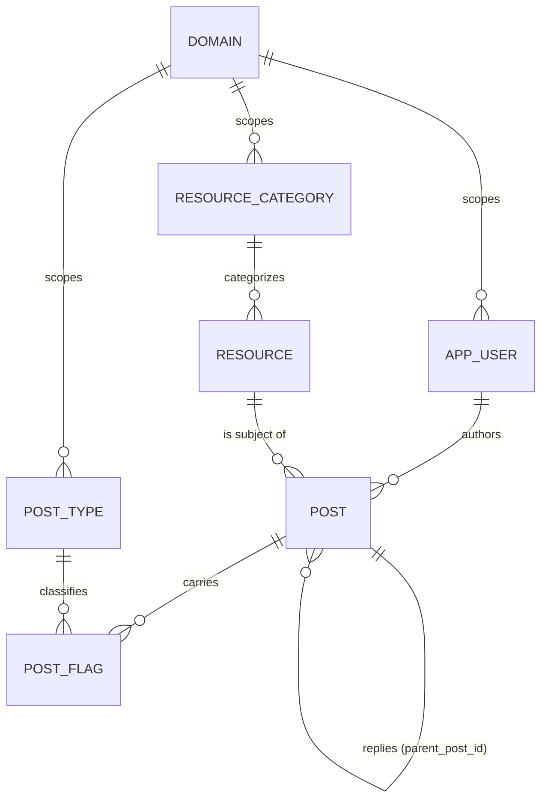

# Posts Service — Database Design Narrative

**Status:** Implemented, kept in step with the canonical spec,
[`design-spec.md`](./design-spec.md), which has the full column
definitions, constraints and decision log.

A plain-language walk through the entity-relationship diagram: what each
box and line means.

## Table of Contents

- [The Diagram](#the-diagram)
- [Reading the Notation](#reading-the-notation)
- [Walking Through Each Relationship](#walking-through-each-relationship)
- [Domain Scoping](#domain-scoping)
- [Putting It Together: One Example](#putting-it-together-one-example)
- [Open Questions](#open-questions)

## The Diagram

Relationships only; every column is in
[`design-spec.md` §4.1](./design-spec.md#41-mermaid-er-diagram).

## Reading the Notation

Each `||--o{` line is one-to-many: `||` marks the "one" side, `o{` the
"zero or more" side. `APP_USER ||--o{ POST : authors` reads: **one
`app_user` authors zero or more `post` rows.** The label after the colon
is just a name for readers; it doesn't affect the schema.

## Walking Through Each Relationship

**`APP_USER ||--o{ POST : authors`**
A user writes many posts (top-level and replies); every post has exactly
one author, via `post.user_id`.

**`RESOURCE_CATEGORY ||--o{ RESOURCE : categorizes`**
`resource_category` is a small lookup table. For the `imdb/*` domains it
holds IMDB's `titleType` values (`movie`, `short`, `tvSeries`,
`tvEpisode`, `tvMiniSeries`, `tvMovie`, `tvSpecial`, `tvShort`, `video`,
`videoGame`), each domain with its own copy. Each row pairs a machine
`name` with a readable `display_name`. A resource points at exactly one
category via `resource.category_id`, so it's a single classification, not
a tag list.

**`RESOURCE ||--o{ POST : "is subject of"`**
A resource (an IMDB title) has many posts; each post belongs to one
resource via `post.resource_id`. This ties a whole thread, the top-level
post and every reply, to the title it's about.

**`POST ||--o{ POST : "replies (parent_post_id)"`**
The self-reference that makes threads. `parent_post_id = NULL` is a
top-level post; otherwise the post is a reply to the post it points at.
Since replies can themselves be parents, nesting is unlimited. A composite
FK (`post (parent_post_id, resource_id) → post (id, resource_id)`,
[`design-spec.md` §4.3](./design-spec.md#43-table-definitions))
guarantees a reply has the same `resource_id` as its parent, so a thread
can't jump to another title.

`post`, like `resource` and `post_flag`, has a nullable `deleted_at` for
soft delete; rows are marked, never removed. Because posts form a tree,
deleting a post hides its whole reply subtree: `deleted_at` is set on the
post and every descendant at delete time, rather than checking ancestors
on every read.

**`POST ||--o{ POST_FLAG : carries`**
A post can carry several flags (say, both racism and sexism), each its own
`post_flag` row linked by `post_flag.post_id`. That's why type and score
aren't columns on `post`. A post has at most one *active* flag per type (a
partial unique index on `(post_id, post_type_id) WHERE deleted_at IS
NULL`); flagging the same type again updates that flag's score.

Today the API attaches one flag per request: `POST /posts` takes a single
`postTypeId`/`score`, and further flags go through
`POST /posts/{postId}/flags` (see [Open Questions](#open-questions)).

**`POST_TYPE ||--o{ POST_FLAG : classifies`**
`post_type` is the second lookup table, holding each domain's flag
categories: `racism`, `sexism`, `lgbtq-phobic` and `no-bigotry` for
`imdb/bigotry`; `skip-it`, `it-was-okay`, `i-enjoyed-it`, `i-loved-it`
for `imdb/standard`. Each `post_flag` points at one `post_type` and has
its own `score` (0–5, 0 = neutral, 5 = most severe). A post with a racism
flag scored 4 and a sexism flag scored 2 is two `post_flag` rows with the
same `post_id` and different `post_type_id`s.

## Domain Scoping

**`DOMAIN ||--o{ RESOURCE_CATEGORY : scopes`** (and likewise `POST_TYPE`,
`APP_USER`)
`domain` partitions the schema so unrelated taxonomies can share one
database. Today it has two rows, `imdb/bigotry` and `imdb/standard`.

- `resource_category`, `post_type` and `app_user` each point at one
  `domain` directly.
- `resource`, `post` and `post_flag` **derive** their `domain_id`; they
  can't choose it:
  - a resource's domain = its category's
  - a post's domain = its resource's = its author's
  - a flag's domain = its post's = its post type's

Each rule is a composite FK against an `(id, domain_id)` pair on the
parent, the same technique as the reply/resource constraint above, one
column wider. So the database itself rejects a post on another domain's
resource, or a flag using another domain's type. Column detail:
[`design-spec.md`](./design-spec.md) decision #11 and
[§4.3](./design-spec.md#43-table-definitions).

## Putting It Together: One Example

In `imdb/bigotry`, a top-level post on "The Room" gets a reply, and the
reply is flagged twice:

| Row | Values |
|---|---|
| `resource` | `The Room`, category → `movie`, domain → `imdb/bigotry` |
| `post` #1 | `resource_id` → The Room, `parent_post_id` → NULL (top-level) |
| `post` #2 | `resource_id` → The Room, `parent_post_id` → 1 (reply to #1) |
| `post_flag` A | `post_id` → 2, `post_type_id` → `racism`, `score` → 4 |
| `post_flag` B | `post_id` → 2, `post_type_id` → `sexism`, `score` → 2 |

Post #2 nests under post #1 and carries two independent flags. Every row
has the same `domain_id` as "The Room", inherited down the chain.

## Open Questions

**Should a post be created with several flags at once?** (deferred)
The schema allows several active flags per post (one per type), but
`POST /posts` takes only one `postTypeId`/`score`. Extra flags need
separate `POST /posts/{postId}/flags` calls, each its own transaction, so
a failure partway leaves some flags missing. If the create form gets a
multi-category picker, the options are:

1. **UI only:** `POST /posts` with the first flag, then
   `POST /posts/{postId}/flags` for the rest. No backend change, but not
   atomic, and the UI must handle partial failure.
2. **UI and API (preferred):** change `PostCreateRequest` to take
   `flags: [{postTypeId, score}, ...]` and have `createPost` call
   `addOrUpdateFlag` for each inside its existing transaction, so the post
   and its flags commit or roll back together. Reject duplicate
   `postTypeId`s, since the upsert would silently merge them.

Product decisions to settle first:
- Multi-flag applies to `imdb/bigotry` only; `imdb/standard` is a single
  rating by design.
- Can `no-bigotry` be combined with `racism`/`sexism`/`lgbtq-phobic` on
  one post, or is it exclusive?
