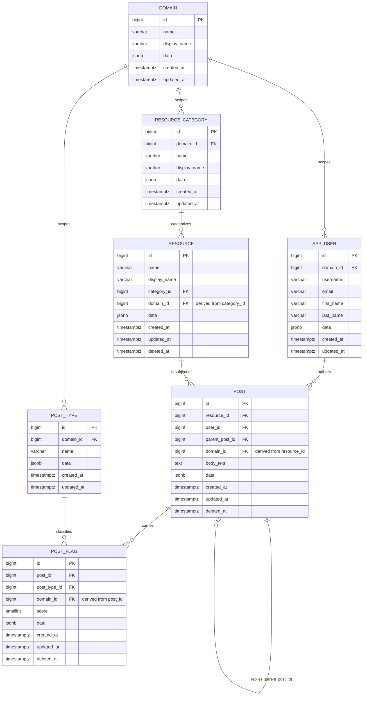
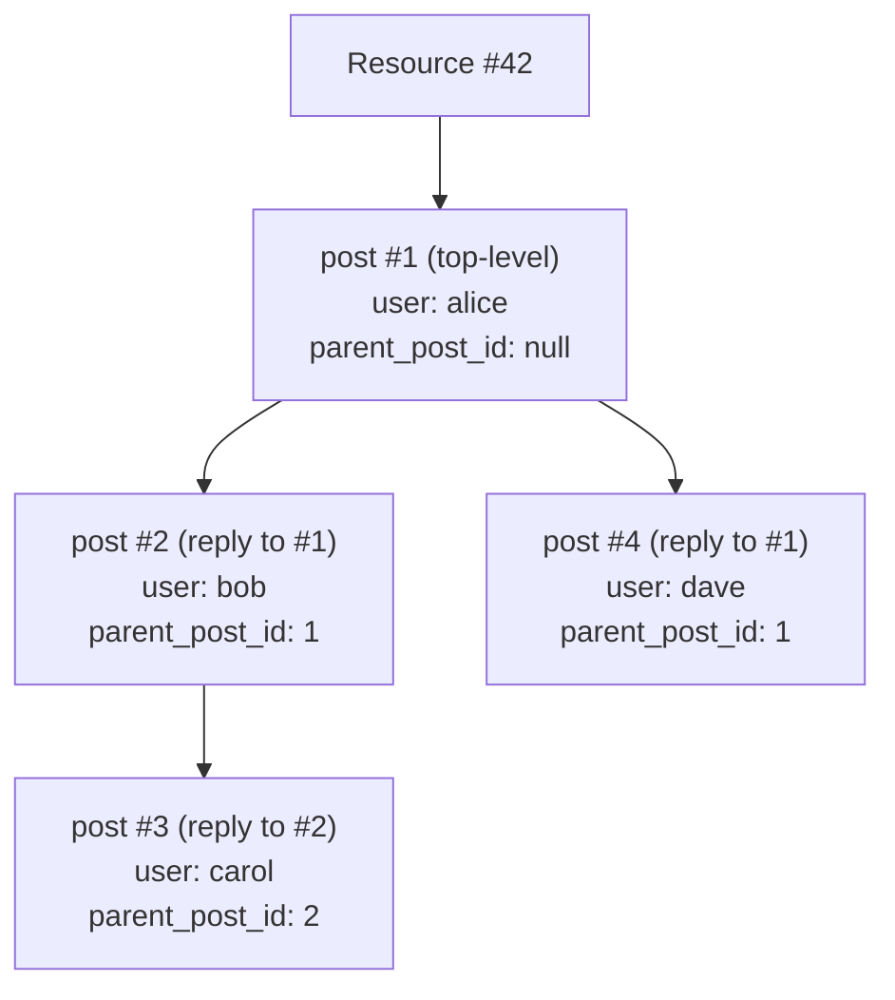

# Posts Service — Design Spec

**Status:** Implemented. The canonical data model, kept current as the
schema changes.

This spec covers the **domain-agnostic** schema: tables, columns,
constraints and rules that hold for every domain. What a given domain's
categories, flag types or resources *are* is seed data, found in that
domain's Flyway migration ([§4.3](#43-table-definitions) points to them).
ERD walkthrough: [`db-design-spec.md`](./db-design-spec.md). How this
generality serves more than IMDB:
[`architecture.md` §8](./architecture.md#8-multi-domain-design).

## Table of Contents

- [1. Overview](#1-overview)
- [2. Decision Log](#2-decision-log)
- [3. Entity Overview](#3-entity-overview)
- [4. Data Model](#4-data-model)
  - [4.1 Mermaid ER Diagram](#41-mermaid-er-diagram)
  - [4.2 Example Thread Shape](#42-example-thread-shape)
  - [4.3 Table Definitions](#43-table-definitions)
- [5. Business Rules Summary](#5-business-rules-summary)
- [6. Open Questions](#6-open-questions-not-yet-answered--do-not-build-against-these)
- [7. Tech Stack](#7-tech-stack)

## 1. Overview

Users post about a **resource**, a catalog item scoped to a **domain** (a
partition that lets unrelated taxonomies share the schema; decision #11).
Others reply under any post, forming an unbounded thread per resource. A
post can be flagged with one or more **post types** (a per-domain
taxonomy, such as content-warning categories or a rating scale), each flag
with its own 0–5 score (0 = neutral, 5 = highest; meaning defined per
domain).

Both seeded domains, `imdb/bigotry` and `imdb/standard`, are IMDB-catalog
variants, but the schema assumes nothing about that.

## 2. Decision Log

Confirmed decisions resolving gaps in the original `requirements.txt`:

| # | Decision | Rationale |
|---|----------|-----------|
| 1 | `post` and `users_posts` are **merged into one `post` table**, self-referencing via `parent_post_id`. | The original draft had two overlapping tables. |
| 2 | `resource_category` is a **per-domain lookup table**; `resource` has one `category_id` FK. | One category per resource, not many-to-many tags. |
| 3 | Reply nesting is **unlimited depth** via `parent_post_id`. | True threaded comments. |
| 4 | A post can carry **several type flags**, each with its own score, via `post_flag(post_id, post_type_id, score)`. | One post can be flagged under several types at different severities. |
| 5 | `post` and `post_flag` are **soft-deleted** (`deleted_at timestamptz`, nullable). | No hard deletes of user content; users edit/delete their own posts and flags. |
| 6 | `post_flag` uniqueness is a **partial unique index**: `UNIQUE (post_id, post_type_id) WHERE deleted_at IS NULL`. | Soft-deleting a flag mustn't block re-adding that type. |
| 7 | `resource` rows come mainly from an external ingestion process; `POST /resources` also allows direct creation. | Bulk catalogs need a bulk path. |
| 8 | `resource` API is **Create, Read, Delete; no Update**. | Scope for the current phase. |
| 9 | `resource` is also **soft-deleted**. | `post.resource_id` is a hard FK, so a hard delete would fail or cascade-destroy posts. |
| 10 | Soft-deleting a `post` **cascades to its whole reply subtree**. | Replies are hidden along with the deleted post. |
| 11 | Every table is scoped to a **domain** lookup table. `resource_category`/`post_type`/`app_user` own a `domain_id`; `resource`/`post`/`post_flag` get a *derived* `domain_id`, enforced by composite FKs, never client-set. | Unrelated domains share the schema without mixing data. Migrations `V7`–`V13`. |
| 12 | `post_flag.score` range is **0–5**, not 1–5. `0` is an explicit "neutral" data point, distinct from having no flag of that type. | `V15__widen_post_flag_score_range.sql`. Aggregates like `/rankings` pull toward 0 when neutral flags are included, as intended. |

Engineering defaults added for consistency (revisit if unwanted):

- **`user` → `app_user`**, because `user` is reserved in Postgres.
- **Audit columns** `created_at`/`updated_at` on every table.
- **`data jsonb`** on every table, for per-domain extra fields without a
  schema change.
- **Replies inherit the parent's `resource_id`**, enforced by composite FK
  ([§4.3](#43-table-definitions)).
- **`resource.name` is the external natural key** from the domain's source
  system (IMDB `tconst` for `imdb/*`), with `display_name` as the label.
  Validating it against that source is an open question
  ([§6](#6-open-questions-not-yet-answered--do-not-build-against-these)).

## 3. Entity Overview

- **domain**: partitions all other data (decision #11).
- **app_user**: a registered user and post author. Per domain.
- **resource_category**: per-domain resource taxonomy (IMDB title types
  for `imdb/*`). Seeds live in each domain's migration.
- **resource**: the catalog item posts are about. Domain derived from its
  category.
- **post_type**: per-domain flag/label categories. Seeds live in each
  domain's migration.
- **post**: a post about a resource, or a reply to a post. Domain derived
  from its resource; the author must be in the same domain.
- **post_flag**: attaches a `post_type` + score (0–5) to a `post`. Domain
  derived from its post; the type must be in the same domain.

## 4. Data Model

### 4.1 Mermaid ER Diagram



The derived `domain_id` on `resource`, `post` and `post_flag` is never
client-set. Composite FKs (e.g. `resource (category_id, domain_id) →
resource_category (id, domain_id)`) keep it equal to its source row's
domain; the SQL is with each table in [§4.3](#43-table-definitions).

### 4.2 Example Thread Shape

How `parent_post_id` nests replies under one resource:



### 4.3 Table Definitions

Every table also has `data jsonb` and `created_at`/`updated_at
timestamptz NOT NULL DEFAULT now()`; they're omitted below. `deleted_at`
(where present) is a nullable soft-delete marker: `NULL` means active.

Tables that other tables reference by `(id, domain_id)` carry an extra
`UNIQUE (id, domain_id)` constraint so the composite FK has a target. The
primary key stays `id` alone. These are `app_user`, `resource_category`,
`resource`, `post_type` and `post`.

**domain**

| Column | Type | Constraints |
|---|---|---|
| id | bigint | PK |
| name | varchar | NOT NULL, UNIQUE; machine key, e.g. `imdb/bigotry` |
| display_name | varchar | NOT NULL |

Seeds: `V7`, `V14`, `V17` (`imdb/bigotry`, `imdb/standard`).

**app_user**

| Column | Type | Constraints |
|---|---|---|
| id | bigint | PK |
| domain_id | bigint | NOT NULL, FK → domain.id |
| username | varchar | NOT NULL, `UNIQUE (domain_id, username)` |
| email | varchar | NOT NULL, `UNIQUE (domain_id, email)` |
| first_name | varchar | |
| last_name | varchar | |

**resource_category**

| Column | Type | Constraints |
|---|---|---|
| id | bigint | PK |
| domain_id | bigint | NOT NULL, FK → domain.id |
| name | varchar | NOT NULL, `UNIQUE (domain_id, name)`; machine key |
| display_name | varchar | NOT NULL; human-readable label |

Seeds are per domain, e.g. `V2__seed_lookup_tables.sql` for the IMDB
`titleType` taxonomy the `imdb/*` domains use.

**resource**

| Column | Type | Constraints |
|---|---|---|
| id | bigint | PK |
| domain_id | bigint | NOT NULL; **derived from `category_id`** (composite FK below) |
| name | varchar | NOT NULL, `UNIQUE (domain_id, name)`; external natural key |
| display_name | varchar | NOT NULL |
| category_id | bigint | NOT NULL, FK → resource_category.id |
| deleted_at | timestamptz | Soft delete, so deleting a resource can't orphan or destroy its posts |

```sql
ALTER TABLE resource
    ADD CONSTRAINT fk_resource_category_same_domain
    FOREIGN KEY (category_id, domain_id) REFERENCES resource_category (id, domain_id);
```

**post_type**

| Column | Type | Constraints |
|---|---|---|
| id | bigint | PK |
| domain_id | bigint | NOT NULL, FK → domain.id |
| name | varchar | NOT NULL, `UNIQUE (domain_id, name)` |

Seeds are per domain: `V14`/`V16` for `imdb/bigotry`'s severity flags,
`V17` for `imdb/standard`'s rating types.

**post**

| Column | Type | Constraints |
|---|---|---|
| id | bigint | PK |
| domain_id | bigint | NOT NULL; **derived from `resource_id`** (composite FKs below) |
| resource_id | bigint | NOT NULL, FK → resource.id |
| user_id | bigint | NOT NULL, FK → app_user.id (author) |
| parent_post_id | bigint | NULLABLE, FK → post.id (NULL = top-level) |
| body_text | text | NOT NULL |
| deleted_at | timestamptz | Set when the author deletes the post |

A reply shares its parent's resource, and a post's domain matches both its
resource's and its author's:

```sql
ALTER TABLE post ADD CONSTRAINT uq_post_id_resource UNIQUE (id, resource_id);
ALTER TABLE post ADD CONSTRAINT fk_post_parent_same_resource
    FOREIGN KEY (parent_post_id, resource_id) REFERENCES post (id, resource_id);

ALTER TABLE post
    ADD CONSTRAINT fk_post_resource_same_domain
    FOREIGN KEY (resource_id, domain_id) REFERENCES resource (id, domain_id);
ALTER TABLE post
    ADD CONSTRAINT fk_post_user_same_domain
    FOREIGN KEY (user_id, domain_id) REFERENCES app_user (id, domain_id);
```

**post_flag**

| Column | Type | Constraints |
|---|---|---|
| id | bigint | PK |
| domain_id | bigint | NOT NULL; **derived from `post_id`** (composite FKs below) |
| post_id | bigint | NOT NULL, FK → post.id |
| post_type_id | bigint | NOT NULL, FK → post_type.id |
| score | smallint | NOT NULL, `CHECK (score BETWEEN 0 AND 5)`; 0 = neutral (decision #12) |
| deleted_at | timestamptz | Set when the author removes the flag |

A flag's domain matches both its post's and its type's, and only one
active flag per `(post_id, post_type_id)` is allowed:

```sql
ALTER TABLE post_flag
    ADD CONSTRAINT fk_post_flag_post_same_domain
    FOREIGN KEY (post_id, domain_id) REFERENCES post (id, domain_id);
ALTER TABLE post_flag
    ADD CONSTRAINT fk_post_flag_type_same_domain
    FOREIGN KEY (post_type_id, domain_id) REFERENCES post_type (id, domain_id);

CREATE UNIQUE INDEX uq_post_flag_active_post_type
    ON post_flag (post_id, post_type_id)
    WHERE deleted_at IS NULL;
```

Flagging a type that already has an active flag updates its score instead
of inserting a duplicate.

## 5. Business Rules Summary

1. A post belongs to exactly one resource (directly, or via its thread's
   root).
2. `parent_post_id = NULL` is a top-level post; non-null is a reply, at any
   depth.
3. A post has zero or more flags, each a `post_type` + 0–5 score
   (0 = neutral).
4. A resource has exactly one category.
5. Users can edit their own post in place (overwrites `body_text`, no
   history) and soft-delete their own posts or flags. Nothing is ever
   hard-deleted.
6. Soft-deleting a post cascades to its whole reply subtree.
7. Every domain-scoped request carries `X-Domain`; a missing or unknown
   domain is rejected, never defaulted. No resource, post or flag can
   cross the domain of the row it derives from (decision #11).

## 6. Open Questions (not yet answered — do not build against these)

- **`POST /resources` validation.** Should resources be validated against
  the domain's source dataset (IMDB `title.basics.tsv` for `imdb/*`), or
  accepted with any `name`/category? Currently unvalidated.
- **Cascading soft delete.** Implemented as a write-time recursive cascade
  (decision #10). Long term, should "hidden because an ancestor was
  deleted" be computed at read time instead, so each row's `deleted_at`
  means "this row was deleted"?
- **Auth/authz.** Deferred. Roles (e.g. moderator) would likely need an
  `app_user.role` column or a roles table, designed when this is tackled.
- **Moderation workflow.** Deferred.

## 7. Tech Stack

Spring Boot (Spring REST + Spring Data JPA), PostgreSQL. Implementation:
[`architecture.md`](./architecture.md).
