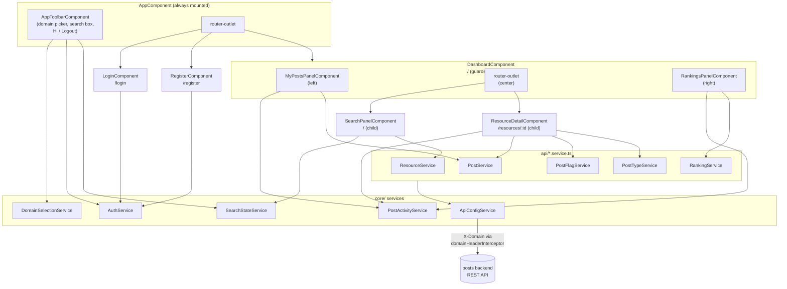

# imdb-ui-angular — Architecture

How this app is structured, how it talks to the backend, and, most
importantly, how one build serves several domains from a runtime picker.

Not the product spec: screens, flows and business rules are in
[`design-spec.md`](./design-spec.md). Install/run/troubleshoot:
[`running-locally.md`](./running-locally.md). The backend API:
[`backend/posts/docs/architecture.md`](../../../backend/posts/docs/architecture.md).

## Table of Contents

- [1. What This App Is](#1-what-this-app-is)
- [2. Component Architecture](#2-component-architecture)
- [3. Routing & Navigation](#3-routing--navigation)
- [4. Domain Configuration System](#4-domain-configuration-system)
- [5. State Management](#5-state-management)
- [6. API Layer & Runtime Configuration](#6-api-layer--runtime-configuration)
- [7. Auth](#7-auth)
- [8. Testing](#8-testing)
- [9. Deployment](#9-deployment)
- [10. TODO / Future Work](#10-todo--future-work)
- [11. Related Documents](#11-related-documents)

## 1. What This App Is

An Angular 22 SPA (standalone components, Signals, `OnPush` throughout)
for the `posts` backend. One build serves every configured domain from a
toolbar picker: today `imdb/bigotry` ("Big-O-Meter", severity-scored
flags) and `imdb/standard` ("Movie-Meter", a plain rating).

The core idea: everything domain-specific (rating mode, badge colors,
conflict rules, theme) lives in one `DomainConfig` per domain
([§4](#4-domain-configuration-system)), not in component branches. This
mirrors the backend's domain scoping
([backend §8](../../../backend/posts/docs/architecture.md#8-multi-domain-design)).

## 2. Component Architecture

## 3. Routing & Navigation

| Path | Component | Guard |
|---|---|---|
| `/login` | `LoginComponent` | none |
| `/register` | `RegisterComponent` | none |
| `/` | `DashboardComponent` → child `SearchPanelComponent` | `authGuard` |
| `/resources/:id` | `DashboardComponent` → child `ResourceDetailComponent` | `authGuard` |
| `**` | redirects to `/` | none |

`DashboardComponent` stays mounted across both child routes; only the
center `<router-outlet>` swaps between search results and resource detail.
That keeps the left (my posts) and right (rankings) panels visible and
loaded. All routes are lazy (`loadComponent`). `authGuard`
(`core/auth.guard.ts`) redirects to `/login` when
`AuthService.currentUser()` is unset.

## 4. Domain Configuration System

Each domain's behavior and look live in one `DomainConfig`
(`core/domain/domain-config.model.ts`):

| Field | Purpose |
|---|---|
| `value` | The `X-Domain` header value and picker key (e.g. `imdb/bigotry`). |
| `label`, `description`, `enabled` | Picker text. `enabled: false` reserves a slot without making it selectable. |
| `rating.mode` | `'severity-score'` (shows a 0–5 score field) or `'category-only'` (no score field). |
| `rating.severity` / `rating.fixedScoreValue` | Score range and "severe" threshold for `severity-score`; the constant score sent with every flag for `category-only`, because the backend's `post_flag.score` is `NOT NULL` ([`design-spec.md` §4](./design-spec.md#4-domain-specific-business-rules)). |
| `badgeClassFor(postTypeName, score)` | Maps a flag to a CSS badge class. |
| `neutralPostTypeName` | The domain's "neutral" post type (bigotry's `no-bigotry`), or `null`. Turns the conflict dialog and ranking post-processing on or off. |
| `postProcessRankings?(rankings, postService)` | Optional client-side ranking filter (bigotry's severity-based `no-bigotry` filtering). Most domains omit it. |
| `findConflictingPosts` / the conflict dialog | Bigotry's cross-post rule, keyed off `neutralPostTypeName` rather than a hardcoded string. |
| `themeTokens` | CSS custom properties applied to `:root` while the domain is active: its whole skin. Bigotry uses `{}` because its colors are the defaults in `styles.css`. |

Configs are registered in `DOMAIN_REGISTRY`
(`core/domain/domain-registry.ts`: `IMDB_BIGOTRY_CONFIG`,
`IMDB_STANDARD_CONFIG`). The picker's `DOMAIN_OPTIONS`
(`domain-options.ts`) is derived from the registry, never edited by hand.

```mermaid
flowchart LR
    Picker["Toolbar domain <select>"] -->|select domain| DomainSel["DomainSelectionService"]
    DomainSel -->|persists to| Storage[("localStorage")]
    DomainSel -->|computed| Active["activeDomainConfig"]
    Active -->|effect: apply| Root[":root CSS custom properties"]
    Active -->|rating.mode, badgeClassFor,\nneutralPostTypeName, ...| Components["ResourceDetail, SearchPanel,\nRankingsPanel"]
    DomainSel -->|selectedDomain| Interceptor["domainHeaderInterceptor"]
    Interceptor -->|X-Domain header| Backend[("posts backend")]
```

Switching domains (`DomainSelectionService.select()`) logs the user out
and goes to `/login`, because backend accounts are per-domain. The theme
`effect()` reacts to the same signal, so the login page already shows the
new domain's skin.

**Adding a domain:** one new file in `core/domain/configs/` implementing
`DomainConfig`, plus one line in `DOMAIN_REGISTRY`. Nothing else changes.
The backend side (seeding `resource_category`/`post_type` rows) is in
[backend §8.3](../../../backend/posts/docs/architecture.md#83-adding-a-domain-today-imdb-variants).

## 5. State Management

No store library. Shared state lives in root-provided, signal-backed
services that templates read directly:

- **`AuthService`**: the logged-in user, mirrored to `localStorage`
  ([§7](#7-auth)).
- **`DomainSelectionService`**: the active domain and its config
  ([§4](#4-domain-configuration-system)).
- **`SearchStateService`**: search results, loading and error state. The
  search box is in the always-mounted toolbar but results render in the
  routed center panel, so neither component can own the state. It resets
  on every login, logout or register so a new session never sees stale
  results.
- **`PostActivityService`**: a "something changed" counter. The side panels
  load once and stay mounted, so this is how they learn a post was created
  on the routed detail page.

Per-viewer layout prefs (dashboard panel widths, the detail table's column
width) go straight to `localStorage` from the owning component, since
nothing else reads them.

## 6. API Layer & Runtime Configuration

`api/*.service.ts` has one thin `HttpClient` wrapper per backend aggregate
(`ResourceService`, `PostService`, `PostFlagService`, `PostTypeService`,
`RankingService`), returning interfaces that mirror the backend DTOs.

Two interceptors (in `app.config.ts`) run on every request:

- **`domainHeaderInterceptor`** adds `X-Domain: <selectedDomain>`.
- **`errorInterceptor`** turns the backend's RFC 7807 `ProblemDetail` into
  an `AppHttpError` with a display-ready message, so components never
  parse error bodies.

**The backend URL is resolved at runtime, not build time.** Every API
service reads `ApiConfigService.baseUrl()`. It defaults to `API_BASE_URL`
(`http://localhost:8080`) and is overridden by a `provideAppInitializer`
(`loadApiConfig()`) that fetches `/config.json` before bootstrap
completes. `docker-entrypoint.sh` writes that file at container startup
from the `API_BASE_URL` env var ([§9](#9-deployment)), so one image works
with any backend. In unit tests the initializer never runs, so
`baseUrl()` is always the `API_BASE_URL` constant and specs assert against
it directly.

## 7. Auth

Placeholder auth with no password, session or token, matching the
backend's posture
([backend §5](../../../backend/posts/docs/architecture.md#5-rest-api-surface),
[§9.2](../../../backend/posts/docs/architecture.md#92-security--cors)):

- **Login:** `AuthService.login(username)` calls
  `GET /dev/users/by-username/{username}`. `404` means no account.
- **Register:** `AuthService.register(username, email)` calls
  `POST /dev/users`. `409` means a duplicate username or email.
- The account is stored in a signal and mirrored to `localStorage`, so a
  refresh keeps you logged in. Later calls send `id`/`username` only where
  a DTO already has a `userId`/`username` field. There's no
  `Authorization` header.

`AuthService`'s public API (`login`/`register`/`logout`/`currentUser`) is
IdP-agnostic: adding a real provider changes only the inside of
`login`/`register`.

## 8. Testing

`ng test` runs the whole Vitest suite (services, interceptors, guards,
components) against `HttpClientTesting`, with no backend. Commands are in
[`running-locally.md`](./running-locally.md).

## 9. Deployment

A multi-stage `Dockerfile` builds with Node and serves
`dist/imdb-ui-angular/browser` with nginx. At startup,
`docker-entrypoint.sh` writes `/config.json` from `API_BASE_URL` before
nginx starts ([§6](#6-api-layer--runtime-configuration)), so the same
image works against any backend. Stack wiring (`FRONTEND_PORT`, CORS
origin, the compose service): [root `CLAUDE.md`](../../../CLAUDE.md) and
[root `README.md`](../../../README.md).

## 10. TODO / Future Work

- **Live updates for `PostActivityService`** ([§5](#5-state-management)).
  The side panels only refresh when the detail page in the same tab bumps
  the signal. Changes from another tab or user stay invisible until a
  manual refresh. Undecided between:
  - **Polling:** cheapest (an interval refetch behind the existing
    signal), but constant request volume and a staleness window.
  - **WebSockets:** push, no staleness, but the backend has no push or
    session infrastructure yet, and this side needs reconnect/backoff.

## 11. Related Documents

| Document | Covers |
|---|---|
| [`design-spec.md`](./design-spec.md) | Screens, flows, decision log, domain-specific business rules |
| [`user-guide.md`](./user-guide.md) | Screenshot walkthrough for end users |
| [`running-locally.md`](./running-locally.md) | Installing, running, testing, troubleshooting |
| [`backend/posts/docs/architecture.md`](../../../backend/posts/docs/architecture.md) | The REST API and the backend's multi-domain design |
